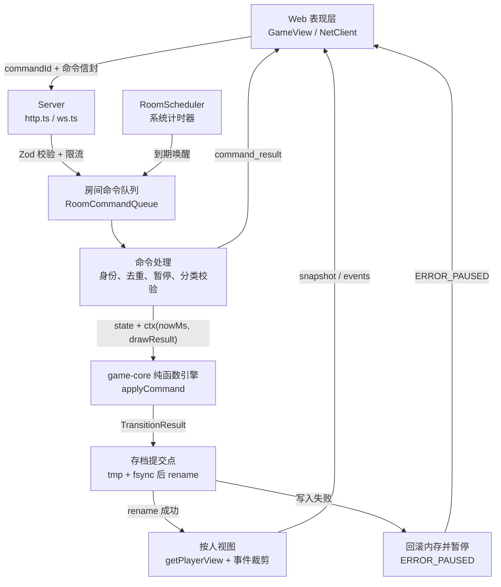

# RichMan 架构说明

> 参赛材料 · 对应代码版本 1.0.2（协议版本 1、规则版本 1.3.2）
> 更新日期：2026-11-19
> 依据：`AGENTS.md`、`docs/plans/Richman分阶段联机开发方案_V1.3精简施工版.txt`、`packages/`、`apps/`、`handoff/项目当前状态.txt`

## 1. 项目定位

RichMan 是**浏览器端多人联机大富翁（回合制金融生存玩法）**：2～10 名玩家各自从 100 金币起步，依次经历计息、银行到期、行动、下注、纳税与破产判定，最后一名未破产者获胜；**规则判定全部在服务端执行，规则引擎是无 IO 的纯函数**，浏览器只负责发送命令和渲染服务端下发的视图。

## 2. 分层架构

### 2.1 分层总览

| 层 | 目录 | 核心职责 | 明确的边界 |
| --- | --- | --- | --- |
| 共享契约层 | `packages/shared/src/` | 金额内核（Cents）、协议 Zod schema、错误码与文案、冻结规则常量、共享数据类型与 AI 人格枚举 | 最底层，不依赖任何内部包；不访问网络、文件、时钟 |
| 规则引擎层 | `packages/game-core/src/` | 纯函数规则引擎：初始化、命令推进、系统推进、暂停恢复、银行/私人借贷/赌博/税收、按人视图 | 禁止访问 socket、文件、系统时钟、浏览器；只依赖 `@richman/shared` |
| 服务层 | `apps/server/src/` | HTTP 静态资源与 `/health`、`POST /api/rooms`、WebSocket 连接、身份会话、每房间命令队列、计时调度、持久化与备份归档、限流安全、AI 驱动 | 只调用引擎，不复制规则计算；权威状态与存档在服务端 |
| 表现层 | `apps/web/src/` | React 页面与引导式操作卡、WebSocket 客户端、倒计时显示、通知与结算展示、音频与教程 | 只渲染服务端 `snapshot`/视图，不运行规则引擎、不维护第二套账本 |

各层的真实文件与入口：

- `packages/shared/src/`：`money.ts`（`Cents`、`MAX_MONEY_CENTS`、金额字符串解析/格式化）、`protocol.ts`（`PROTOCOL_VERSION`、`GameCommandSchema`、`ClientGameCommandSchema`、大厅/服务端消息 schema）、`errors.ts`（`ERROR_CODES`、`ERROR_MESSAGES`）、`rules.ts`（`RULES`、`TIMERS`、`SERVER_DEFAULTS`、`BOTS_MAX`）、`types.ts`（`GameState`、`GameCommand`、`CommandContext`、`TransitionResult`、`PlayerView` 等）、`bots.ts`（AI 人格）。
- `packages/game-core/src/`：`engine.ts`（`createInitialState`、`applyCommand`、`advanceSystem`、`resumeFromPause`、`shiftDeadlinesForPause`、`eventsForPlayer`、`encodeSnapshot`/`decodeSnapshot`）、`bank.ts`、`private-loans.ts`、`gamble.ts`、`tax.ts`、`views.ts`（`getPlayerView`）、`money.ts`（`mulDivFloor`/`mulDivRound`，金额乘除的唯一入口）。
- `apps/server/src/`：`http.ts`（静态目录、`/health`、`/api/rooms`、WebSocket 升级）、`ws.ts`（连接、身份、命令接收、按人广播）、`rooms/manager.ts`（房间与身份事务）、`rooms/command-queue.ts`（`RoomCommandQueue`、`GameCommandProcessor`）、`rooms/scheduler.ts`（`RoomScheduler`）、`rooms/session.ts`、`rooms/recovery.ts`、`rooms/lifecycle.ts`、`storage/file-store.ts`、`storage/atomic.ts`、`storage/backup.ts`、`storage/backup-cli.ts`、`storage/archive-policy.ts`、`security.ts`、`bots/driver.ts`、`bots/policy.ts`。
- `apps/web/src/`：`App.tsx`、`LobbyView.tsx`、`GameView.tsx`、`net/client.ts`（命令信封与快照接收）、`net/wire.ts`（传输层类型）、`game/steps.ts`（引导步骤）、`game/settlement.ts`、`game/bet-outcome.ts`、`game/notices.ts`、`game/DebtCenter.tsx`、`audio/`、`tutorial/`。

### 2.2 依赖方向（单向）

```text
@richman/shared          （最底层，无内部依赖）
      ↑
@richman/game-core       （只依赖 shared）
      ↑
@richman/server          （依赖 shared + game-core）

@richman/web             （源码只依赖 shared）
```

- `packages/shared` 不引用其他工作区包。
- `packages/game-core` 只引用 `@richman/shared`，不引用 `apps/*`。
- `apps/server` 引用 `@richman/game-core` 与 `@richman/shared`，所有规则判定都交给引擎。
- `apps/web/src` 只从 `@richman/shared` 引入协议版本、规则常量与人格标签；`apps/web/package.json` 虽声明了 `@richman/game-core` 的 workspace 依赖，但 `src/` 内没有任何 `game-core` 引用，运行时不使用。前端不复制规则、不计算账务结果。

## 3. 一次操作的完整数据流

以玩家点击「借银行 10 金币」为例，一次命令从浏览器到重新渲染的完整链路：

1. **Web 组命令**：`GameView` 调用 `NetClient` 的对应方法，最终进入 `sendCommand()`。客户端用 `crypto.randomUUID()` 生成 `commandId`，组装信封：`protocolVersion`、`gameId`、`commandId`、`type`、`payload`，并按需附带 `expectedGameVersion`、`roundId`、`phaseInstanceId`。金额在协议上是规范十进制字符串（如 `"1000"` 分）。
2. **WebSocket 发送**：信封通过浏览器原生 WebSocket 发往同源 `/ws?room=<房间码>`；token 不放在 URL 里，恢复时放在消息体内。
3. **Server 接收与校验**：`ws.ts` 用 `ClientGameCommandSchema`（Zod）校验消息；随后经过命令限流（全局桶与经济命令桶），再交给 `GameCommandProcessor.execute()`。
4. **去重与排队**：`RoomCommandQueue` 按房间串行执行任务，同一房间的玩家命令、计时器推进、大厅写入共享同一条队列。处理器先校验身份与 `gameId`；用 `[gameId, playerId, commandId]` 查询命令结果缓存——同一 `commandId` 且载荷哈希一致则直接返回原回执，载荷不同返回 `COMMAND_ID_REUSED`；暂停态返回 `ERROR_PAUSED`。
5. **先处理到期系统动作**：处理器调用 `scheduler.advanceDue()`，在房间队列内先把已到期的计息、到期、超时下注等系统动作推进完，再做本命令的分类校验（如 `expectedGameVersion` 不符返回 `VERSION_CONFLICT`，请求过期返回 `REQUEST_EXPIRED`）。
6. **game-core 纯函数推进**：调用 `applyCommand(state, command, { actorId, nowMs, drawResult })`。引擎克隆旧状态，按规则修改，返回 `TransitionResult`：新 `state`、`events`、结构化 `outcome`、下一截止时间；只有发生有效推进时 `version + 1`，已发布状态不被原地修改。`RULE_INVARIANT` 失败时保留最后一致状态，不提交部分结算。
7. **Server 落存档**：`manager.commitTransition()` 调用文件存储，按 `临时文件写入 + fsync → 备份旧快照 snapshot.bak.json → rename` 的提交点持久化；命令回执与状态在同一次提交中落盘。写入失败则回滚内存并暂停房间（`ERROR_PAUSED`），不会广播成功。
8. **Server 广播新视图**：提交成功后，对房间内每个当前连接调用 `getPlayerView(state, viewerId)`，并用 `eventsForPlayer` / 传输层裁剪生成各自的可见事件（如下注结算只保留本人条目）；向所有在线连接发送 `snapshot` 与 `events`，向命令发起者发送 `command_result`，随后重新安排计时器。
9. **Web 重渲染**：`NetClient.acceptSnapshot()` 丢弃同一局中 `version` 更小的旧快照，只接受不降级的最新视图；`GameView` 用服务端给的 `finance`、`publicPlayers`、`deadlineAt` 等字段重新渲染。客户端倒计时只是按 `serverNow` 估算，规则仍以服务端为准。

失败路径同样结构化：参数/权限/版本/暂停等失败不会改变游戏状态，服务端返回 `command_result`（`ok: false` + `code` + `message`，必要时带 `details`）；若版本没有变化，`ws.ts` 会为本人补发一次 `snapshot`，避免界面停留在旧状态。

## 4. 关键工程约定

### 4.1 金额一律整数分（Cents）

- `Cents = number`，必须是安全整数；上限 `MAX_MONEY_CENTS = 10^12` 分（100 亿金币），这是异常防护边界，不是余额截断规则。
- 协议与存档使用规范十进制字符串（零为 `"0"`，禁止前导零、正号、`"-0"`，最多 13 位数字）；服务端在进入引擎前把金额字段转成整数分。
- 金额乘除只允许走 `mulDivFloor` / `mulDivRound`（内部用 `BigInt` 计算后转回 `number` 并校验），禁止在其他文件直接写 `* 0.1` 之类的浮点运算。
- 展示与输入分别走 `formatCoins` / `parseCoinsInput`；前端只格式化，不重新计算账务。

### 4.2 时间与随机数由外部注入

- 引擎的命令上下文固定为 `CommandContext { actorId, nowMs, drawResult }`；引擎**不读系统时钟、不取随机源**，所有截止时间由 `nowMs` 计算，开奖结果由调用方传入。
- 服务端默认使用 `Date.now()` 与 `randomInt(2)`；`RoomScheduler` 同样接受注入的 `now`/`draw`。测试可注入固定时间与固定开奖结果，从而复现超时、计息与结算。
- 暂停恢复通过 `shiftDeadlinesForPause` 把所有绝对截止时间整体平移暂停时长，恢复后剩余时间与暂停那一刻一致，不补计息、不补开奖。

### 4.3 错误用结构化 outcome

- 引擎与命令处理器的返回值统一为：

  ```ts
  type CommandOutcome =
    | { ok: true }
    | { ok: false; code: ErrorCode; message: string;
        details?: Record<string, string | number | boolean | null> };
  ```

- `code` 给程序判断（如 `VERSION_CONFLICT`、`INSUFFICIENT_FUNDS`、`REQUEST_EXPIRED`、`ERROR_PAUSED`），`message` 给玩家看，`details` 放可执行数据（如催收上限 `limitCents`）。
- 错误码集中在 `packages/shared/src/errors.ts`（游戏命令）与 `protocol.ts` 的大厅错误码中；服务端不另造一套文案。

### 4.4 状态机阶段顺序

一轮的固定顺序：

```text
INTEREST（自动计息）
   → BANK_DUE（逐笔处理到期银行贷款，一次只呈现一笔）
   → ACTION（存活玩家按座位各执行一次主要行动）
   → BETTING（所有存活玩家同时私下锁注，统一开奖）
   → TAX（仅第 3、6、9… 轮：按座位扣税并处理危险自救）
   → 下一轮 INTEREST  或  GAME_OVER
```

- 阶段变化会生成新的 `phaseInstanceId`，用于拒绝过期计时器与过期命令。
- 玩家命令与系统推进共用同一个纯函数引擎；计时器只负责在到期时唤醒房间队列，调用 `advanceSystem`，规则本身不写在定时器或 Socket 回调里。
- 若阶段内所有必需操作提前完成，则立即进入下一阶段，不空等倒计时；超时只做兜底。

### 4.5 一致性与并发约定

- 单进程、每房间串行：玩家命令、计时推进、大厅与身份写入都排在同一条 `RoomCommandQueue` 中。
- `gameVersion` 每次成功提交 +1；在线/心跳变化不 +1。
- `commandId` 整局累积去重：同 ID 同载荷返回原回执，同 ID 不同载荷拒绝。
- 存档是提交点：rename 成功才算提交；失败回滚内存并暂停，恢复后由房主显式继续。

## 5. 数据流图



## 6. 测试规模

以下数字来自本机 2026-11-19 实际运行 `corepack pnpm -s test`（即 `pnpm test` → `vitest run`，非 watch）的输出：

- **Test Files：90 个**（84 passed / 6 failed）
- **Tests：1077 条**（1063 passed / 14 failed）
- 耗时：250.59s
- 退出码：1

本次失败的 14 条集中在依赖 Windows junction 的备份用例、子进程崩溃恢复/IPC 超时用例和脚本超时用例（例如 `backup.test.ts` 的 T21/T23、`crash-recovery.test.ts`、`scripts.test.ts`、`release-lib.test.mjs`），与 `handoff/项目当前状态.txt` 中记录的既有本机环境问题同类；游戏规则与 HTTP/WS 集成测试主体通过。完整输出见 `artifacts/test-logs/arch-doc-test.log`。

类型检查：`corepack pnpm -s typecheck` 退出码 0，无任何输出（无类型错误）；记录见 `artifacts/test-logs/arch-doc-typecheck.log`。

补充：2026-11-18 23:56 在同一仓库跑出过全绿基线（Test Files 90 passed / Tests 1077 passed / 147.28s），本次 14 条失败均集中在依赖 Windows junction 与子进程 IPC 的用例上，属本机环境差异而非代码回归；另见参赛截图 03。
